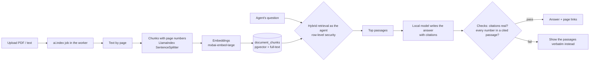

# AI assistant and local AI

## Website AI assistant (customers)

Open with the **AI assistant** button. It understands requests like
"3 bed under 400k in Waterville with a garage", then:

- searches live listings, explaining why each matches, and relaxes the search step by step if nothing fits
  (and says what it relaxed);
- answers questions about schools, commute and walkability for a listing (labeled as estimates);
- quotes local market figures from the market data tables, with source and date;
- lets visitors save the search, request a showing (with consent) or hand off to an agent;
- for signed-in customers, reports the status of their own deal;
- declines fair-housing-sensitive requests (e.g. about the people in a neighbourhood) and explains why.

## Portal assistant (staff)

**Ask ops** in the portal answers questions such as "what's overdue?", "status of the Riley deal" or
"new leads this week" from the database, scoped to what the signed-in person may see.

## Local AI (optional)

AI is **local only**: set `OLLAMA_URL` (e.g. `http://localhost:11434`) and `OLLAMA_MODEL`
(default `llama3.2:3b`) to let Ollama phrase answers more naturally. Without it, built-in deterministic
answers are used and everything still works. No paid or hosted AI is ever called.

Guard-rails: AI text may only mention dollar amounts that already exist in the data
(`onlyKnownAmounts`); otherwise the deterministic text is used. Deal drafts polished by AI must keep every date.

## Meaning-based home search (semantic search)

The AI assistant also understands requests in plain words, such as "somewhere peaceful near water where
I can kayak" or "walk to coffee shops downtown":

1. Hard criteria (town, budget, beds, type…) still filter the listings exactly.
2. The remaining homes are ranked two ways and the rankings are fused (reciprocal-rank fusion):
   - **by meaning:** cosine similarity between the request and each listing's passages, using embeddings
     from a local model (`mxbai-embed-large`) stored in PostgreSQL with **pgvector**;
   - **by keywords:** PostgreSQL full-text ranking of the visitor's own words.
3. When a passage matches strongly, the assistant quotes it ("Near boat launch.") so the visitor sees
   why the home was suggested. Generated summaries are never quoted, only the listing's own words.

If the AI service is off, search falls back to keywords and the assistant still works.

## Ask the documents (RAG, portal)

On every deal page, **Ask the documents** answers questions such as "When is closing?" or "How much is
the earnest money?" from that deal's uploaded files:

Safety:
- **Permissions:** retrieval runs as the signed-in agent, so passages from deals they can't see are never
  retrieved or sent to the model (tested). Customers can't use it.
- **Prompt injection:** document text is fenced as untrusted data and the model is told to ignore
  instructions in it. A planted "ignore all previous instructions" line is part of the browser test.
  Because a small model can still be fooled, the checks below and the visible citations are the real
  protection: always confirm against the cited page.
- **No made-up facts:** every answer must cite a supplied passage, and every number or date in it must
  appear in a cited passage. Otherwise the passages themselves are shown. "The documents don't say" is
  an allowed answer.
- **Failure:** if the AI service or the model is down, the most relevant passages are shown (keyword
  search still works).

Scanned images have no text yet (no OCR), so they're marked as not searchable rather than retried forever.

## AI service (`ml/`)

A small internal Python service (FastAPI + LlamaIndex), called only by the web server and the worker:

| Endpoint | Purpose |
| --- | --- |
| `POST /v1/chunk` | Split pages into overlapping chunks that keep their page number |
| `POST /v1/embed` | Embeddings for queries or documents (with each model's recommended prefixes) |
| `POST /v1/answer` | Write a cited answer from passages and check it |
| `GET /health` | Whether Ollama and both models are available |

It holds no data and no database credentials; permission checks stay in the web app. Set up once with
`scripts/ml-setup.sh` (free: Python packages + Ollama models); `scripts/dev.sh` then starts it on port 8600.
In Docker: `docker compose --profile ai up`, with `ML_SERVICE_URL=http://ml:8600` and `ML_SERVICE_TOKEN`
in `.env`.

## Choosing the embedding model (evaluation)

`ml/eval/retrieval_eval.py` scores search methods on 15 hand-labelled questions
(`ml/eval/retrieval_queries.json`; each lists the homes a person would expect, judged from the listing text):

| Method | Recall@3 | MRR | nDCG@5 |
| --- | --- | --- | --- |
| **Keywords (BM25) + mxbai-embed-large, fused** (used) | **0.822** | **0.880** | **0.871** |
| mxbai-embed-large only | 0.756 | 0.815 | 0.821 |
| Keywords only (BM25) | 0.789 | 0.867 | 0.770 |
| Keywords + nomic-embed-text, fused | 0.722 | 0.715 | 0.741 |
| nomic-embed-text only | 0.722 | 0.721 | 0.705 |

The first model tried (`nomic-embed-text`) was worse than plain keywords on this data, so the site
switched to `mxbai-embed-large` (migration 010). The set is small (8 demo listings), so treat the numbers
as directional and re-run the evaluation when real listings replace the demo ones. Two demo listings
have no description, which limits what any model can find (e.g. "room for horses" doesn't surface the
32-acre farmhouse); better listing text helps more than a bigger model.
