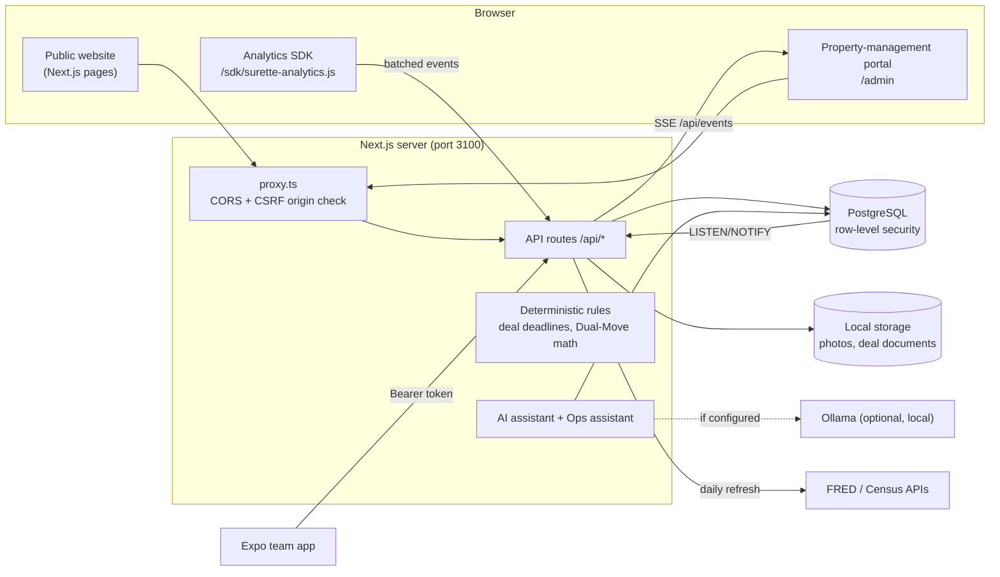

# Architecture

A quick map of the code. For production concerns (scaling, queues, caching, resilience,
monitoring, deployment) see **[system-design.md](system-design.md)**.

## Request flow

1. `src/proxy.ts` applies CORS for configured origins and blocks cookie-authenticated, state-changing
   requests whose `Origin` is foreign (CSRF). The analytics collector is exempt (it uses no cookies).
2. The route reads the session (`sn_session` cookie or `Authorization: Bearer`) and resolves the viewer.
3. Database work runs inside a transaction as the limited role `surette_app` with `app.user_id`,
   `app.role` and `app.team_id` set, so PostgreSQL row-level security decides what rows are visible.
   Code-level checks are a second layer, not the only one.
4. Changes fire `NOTIFY surette_events`; the server fans these out over Server-Sent Events at
   `/api/events`, so the portal, deal pages and shared collections update live.

## Code map

| Path | Purpose |
| --- | --- |
| `web/src/app/(site)` | Public pages: home, listings, map, market, Dual-Move, team, contact, privacy, account |
| `web/src/app/admin` | Portal pages (staff only, guarded server-side) |
| `web/src/app/api` | API routes |
| `web/src/lib/server` | Server-only modules: auth, db, deals, leads, documents, analytics, market, AI |
| `web/src/lib` | Shared pure logic: deal rules, Dual-Move math, money, validation, event allow-list |
| `analytics-sdk/` | The browser tracker (copied into `web/public/sdk` on dev/build) |
| `demo-site/` | Fictional brokerage site used to test the SDK (served at `/demo-site/`) |
| `database/migrations` | SQL migrations, applied in order by `npm run db:migrate` |
| `mobile/` | Expo app for agents (listings, photo upload, showings) |
| `web/scripts/worker.ts`, `web/src/lib/server/worker/` | Background worker: outbox relay, job queue, scheduler |
| `web/scripts/realtime.ts`, `web/src/lib/server/realtime-server.ts` | WebSocket live-update server |
| `deploy/` | nginx gateway, Kubernetes (kustomize), Prometheus/Alertmanager/Grafana/Loki |
| `.github/workflows/` | CI (lint, types, tests, e2e, image) and CD (staging, production) |
