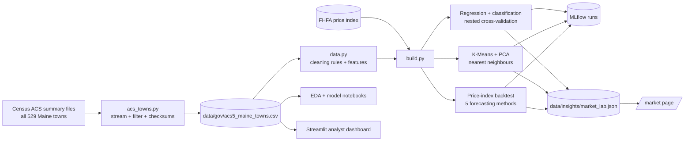
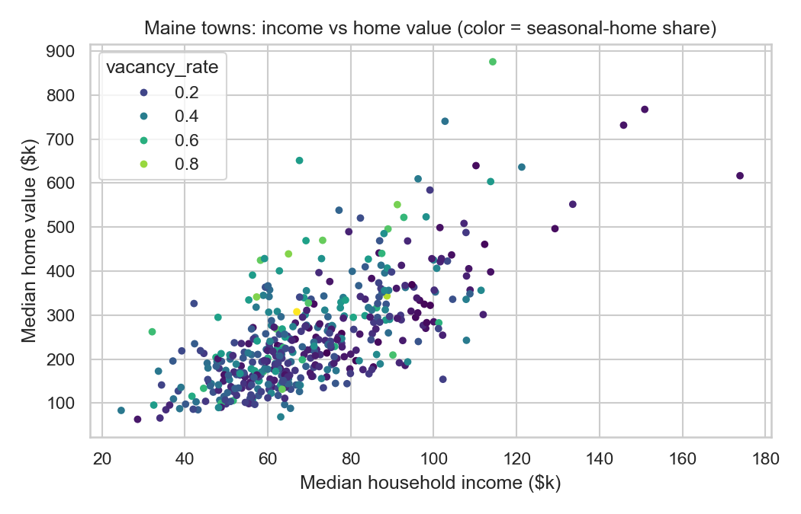
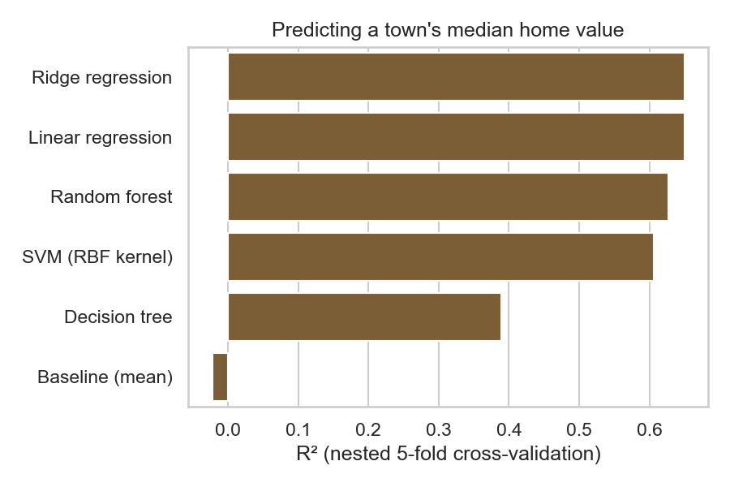
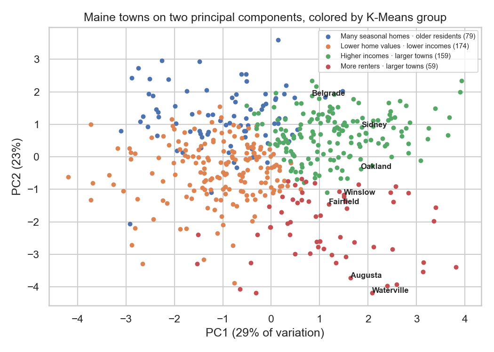
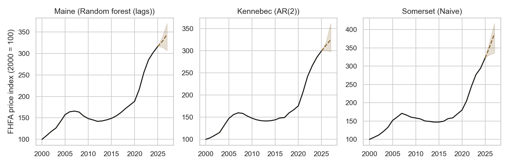

# Market Lab (data analysis and machine learning)

The Market Lab analyses every Maine town with public data and shows the results for our towns on the
website's **/market** page: towns most like each one, how its home values compare with what its incomes
and rents predict, and an outlook for the county price index. Everything is built offline from public
data; the website only reads the results file.



| Piece | Where |
| --- | --- |
| Data download (Census, streamed, checksummed) | `ml/market_lab/acs_towns.py` → `data/gov/acs5_maine_towns.csv` + manifest |
| Cleaning and feature engineering | `ml/market_lab/data.py` |
| Supervised models | `ml/market_lab/models.py` (scikit-learn) |
| Clustering, PCA, similar towns | `ml/market_lab/clusters.py` |
| Price-index forecasting | `ml/market_lab/forecast.py` |
| Build everything + MLflow + results file | `ml/market_lab/build.py` |
| Exploratory analysis and model reports | `ml/notebooks/01_eda.ipynb`, `02_models.ipynb` (executed; read them on GitHub) |
| Analyst dashboard | `ml/market_lab/dashboard.py` (Streamlit) |
| Website section | `web/src/components/site/market-lab.tsx`, `GET /api/market/lab` |

```bash
cd ml
.venv/bin/python -m market_lab.acs_towns         # re-download the Census data (≈165 MB streamed, nothing large stored)
.venv/bin/python -m market_lab.build             # train, evaluate, write data/insights/market_lab.json and docs/market-lab/*.png
.venv/bin/mlflow ui --backend-store-uri sqlite:///mlruns/mlflow.db      # experiment history on http://localhost:5000
PYTHONPATH=. .venv/bin/streamlit run market_lab/dashboard.py             # analyst dashboard on http://localhost:8501
.venv/bin/python notebooks/build_notebooks.py    # re-run the notebooks
```

## Data and cleaning

Census American Community Survey 2020–2024 5-year estimates for all 529 Maine county subdivisions
(towns, cities, plantations, unorganized territories): population, median household income, median home
value, median gross rent, owner-occupied and vacant homes, median age, median year built, each estimate
with its margin of error. Raw values are stored exactly as published.

| Cleaning rule | Effect |
| --- | --- |
| Census "not available" codes (large negative numbers) → missing | 485 values |
| Places with fewer than 100 residents dropped (estimates mostly noise) | 53 places |
| No published median home value → not modelled | 5 towns |
| Median home value too uncertain (coefficient of variation > 30%) → not modelled | 14 towns |
| **Towns used for the models** | **457** |
| Model towns with a missing feature (mostly unpublished rent) | 105, imputed inside each cross-validation fold |

Features: income (log), population (log), annual rent ÷ income, homeownership rate, vacant share of homes
(in Maine mostly seasonal homes: Newry, home of Sunday River, is 94% "vacant"), median age of residents,
median age of homes, and county.



## Supervised learning: what explains a town's median home value?

Target: log(median home value). Each model is a pipeline (impute → standardize → model) fitted inside
cross-validation; tunable models use **nested cross-validation** (inner grid search over the
hyper-parameters, outer 5-fold), so the scores aren't optimistic.

| Model | R² | Median error |
| --- | --- | --- |
| **Ridge regression** (α = 1, tuned) | **0.650** | **15.0%** |
| Linear regression | 0.650 | 15.2% |
| Random forest (tuned) | 0.626 | 16.7% |
| SVM, RBF kernel (tuned) | 0.606 | 14.4% |
| Decision tree (tuned) | 0.389 | 20.7% |
| Baseline (always the mean) | −0.023 | 31.7% |



Regularized linear models win: with about 450 towns and smooth relationships, the extra flexibility of
trees and SVMs adds variance without adding accuracy. By permutation importance, income matters most,
then county, then the seasonal-home share.

**Classification** (is the town above the median of modelled towns, $222,900?):

| Model | ROC-AUC | Accuracy |
| --- | --- | --- |
| Random forest | 0.934 | 85.6% |
| Logistic regression | 0.933 | 85.8% |
| SVM, RBF kernel | 0.926 | 85.1% |
| Decision tree | 0.818 | 76.6% |
| Baseline (majority class) | 0.500 | 50.1% |

Logistic regression is as good as the forest and explains itself: each standard deviation of higher
income multiplies the odds of being above the median by 9.5; population by 3.3; seasonal-home share by 2.4.

**On the website** ("Home values vs. local incomes and rents"): each town's value is compared with the
ridge model's *out-of-fold* estimate (from a model that never saw that town). The page only says a town is
higher or lower when the gap is bigger than the model's typical ±15% error; otherwise it says "in line".
Today Waterville is −13% (in line), Sidney +28% (higher; likely land and lake features the census doesn't
capture). It's context, not an appraisal.

## Unsupervised learning: groups, a map, and similar towns

Profile features are standardized; K-Means with k chosen by silhouette (k = 4); PCA for a 2-D map; nearest
neighbours for "towns most like this one".

| Group | Towns |
| --- | --- |
| Many seasonal homes · older residents | 79 |
| Lower home values · lower incomes | 174 |
| Higher incomes · larger towns | 159 |
| More renters · larger towns | 59 |



The silhouette score is low (0.18): Maine towns form a continuum, so groups are summaries, not categories.
Nearest neighbours are the useful output: Waterville's are Lewiston, Bangor, Augusta, Old Town and Brewer
(regional service-centre cities). The two principal components explain 52% of the variation.

## Forecasting the price index

FHFA annual all-transactions index (2000 = 100) for Maine, Kennebec and Somerset. Five methods (naive,
drift, linear trend, AR(2), random forest on lagged growth) are compared with a **rolling-origin backtest**:
for every year since 2005, fit on data up to that year only and forecast 1 and 2 years ahead.

| Area | Chosen method | Backtest error, 1 year | 2 years | 2026 outlook (likely range) |
| --- | --- | --- | --- | --- |
| Maine | Random forest (lags) | ±2.7% | ±6.0% | 328 (315–339) |
| Kennebec | AR(2) | ±2.4% | ±5.4% | 312 (301–320) |
| Somerset | Naive | ±3.3% | ±7.2% | 354 (331–368) |



The range is the 10th–90th percentile of the chosen method's own past errors. It describes the area index,
not any single home, and isn't financial advice. Somerset's naive method repeats last year's 9% rise, so its
two-year range is wide.

## MLflow

Every build records four runs in the `market-lab` experiment (regression, classification, clusters,
price-index backtest): parameters, every model's metrics, the SHA-256 of the input files, and the fitted
regression pipeline as a logged model. Runs are stored locally in `ml/mlruns/` (not committed).
