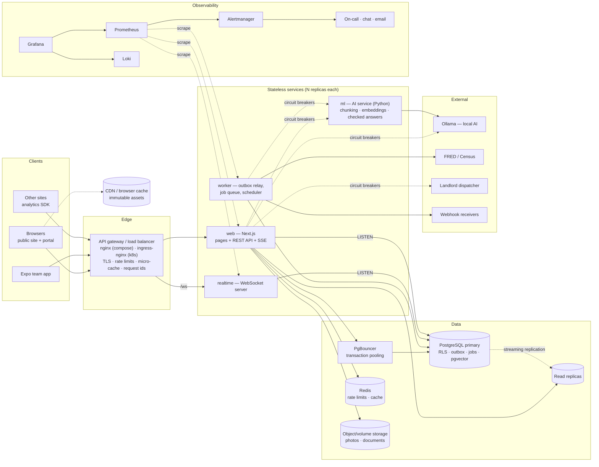
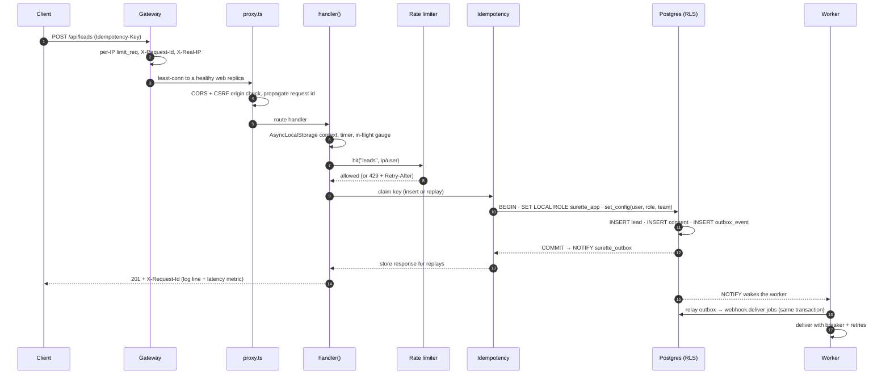
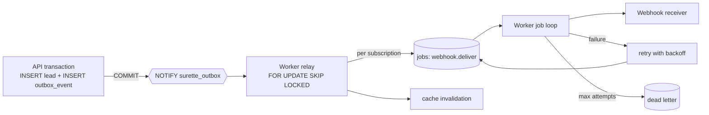
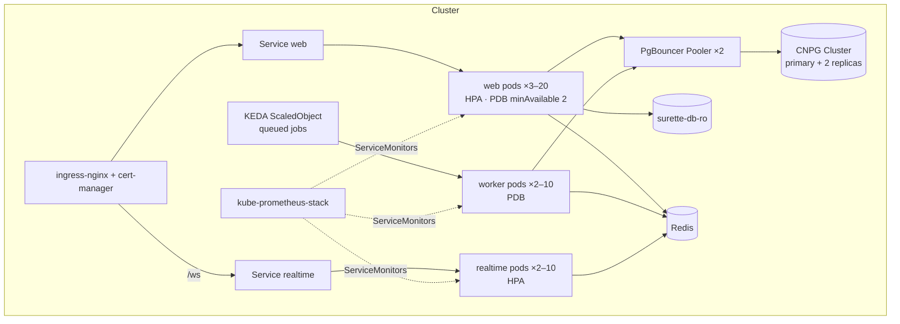
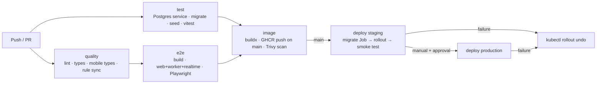

# System design

How Surette Nexus is built to stay fast, correct and observable as it grows: from one laptop, to a
small Docker host, to a Kubernetes cluster. Everything here is free/open-source software; nothing
requires a paid service.

> **What's verified.** The application code (rate limiting, caching, idempotency, circuit breakers,
> queue, outbox, WebSockets, health checks, logs, metrics) is covered by automated tests. The full
> Docker Compose stack (two web instances, worker, WebSocket server, Postgres, Valkey, nginx
> gateway) has been built and run locally, and the browser tests pass through the gateway. Alert
> rules, Alertmanager routing and Kubernetes manifests pass their official validators, and the
> GitHub Actions CI pipeline passes on GitHub. Not yet run: a real Kubernetes cluster, the
> Prometheus/Grafana/Loki containers, and the deploy workflow (they need hosting).
> See [Verification status](#verification-status).

## 1. Goals and constraints

| Goal | What it means here |
| --- | --- |
| Correct first | Money in integer cents, PostgreSQL row-level security on every request, no duplicate leads or deals from retries, no lost events |
| Fast for visitors | Public pages and listing APIs answer from cache; images are pre-sized WebP; live updates are pushed instead of polled |
| Degrade, don't fail | If AI, FRED, Census, the dispatcher, Redis or a webhook receiver is down, the site keeps working with fallbacks |
| Scale horizontally | Every process is stateless; shared state lives in Postgres (and optionally Redis); any number of replicas |
| Observable | Every request has an id, a structured log line and metrics; every alert has a runbook |
| Free / OSS | Postgres, Valkey (Redis-compatible), nginx, Prometheus, Grafana, Loki, Alertmanager, KEDA, CloudNativePG, Ollama |

Expected load is modest (a regional brokerage: hundreds to low thousands of visitors a day), so
the design favours **few moving parts now** with a **clear path** to more when numbers justify it.

## 2. Architecture

| Component | Responsibility | State | How it scales |
| --- | --- | --- | --- |
| **web** (Next.js) | Pages, REST API, SSE stream, request auth, RLS-scoped queries | none (L1 cache only) | HPA on CPU/memory, 3 to 20 replicas |
| **realtime** | WebSocket live updates | open sockets only | HPA on CPU; each replica LISTENs to Postgres directly |
| **worker** | Outbox relay, job processing, scheduled jobs | none | KEDA on queue depth, 2 to 10 replicas; SKIP LOCKED makes them safe to run in parallel |
| **gateway** | TLS, routing, rate limits, micro-cache, request ids | cache (disposable) | Cloud LB / ingress controller replicas |
| **PostgreSQL** | Source of truth, RLS, outbox, queue, idempotency keys | durable | Vertical first; read replicas; partitioning for analytics |
| **PgBouncer** | Connection pooling (transaction mode) | none | 2 replicas |
| **ml** (FastAPI + LlamaIndex) | Chunking, embeddings, cited answers with checks; holds no data, never sees rows the user can't | none | Replicas behind a Service; CPU-bound on the model server (Ollama), which scales separately |
| **Redis** (optional) | Shared rate-limit counters, shared cache, invalidation pub/sub | disposable | Single node is plenty; managed Redis for HA |

Code map: `web/src/lib/server/*` (one module per concern, named below), `web/scripts/worker.ts`,
`web/scripts/realtime.ts`, `deploy/` (gateway, Kubernetes, observability), `.github/workflows/`.

## 3. Life of a request

## 4. API gateway and load balancing

**Where:** `deploy/nginx/nginx.conf` (Docker Compose) and `deploy/k8s/base/ingress.yaml` (ingress-nginx).

- **Routing:** `/ws` goes to *realtime* (WebSocket upgrade, 1 h timeouts); `/api/events` goes to
  *web* with buffering off (SSE); `/api/properties/upload` streams bodies up to 1.2 GB with no
  request buffering; everything else goes to *web*.
- **Load balancing:** `least_conn` across replicas, upstream keep-alive, passive health checks
  (`max_fails=3 fail_timeout=10s`). In Kubernetes, readiness probes remove unhealthy pods from the
  Service.
- **Retries:** another replica is tried only on connection errors and 502/503, and **only for
  idempotent methods**. nginx never retries POST/PATCH unless told to with `non_idempotent`, and
  we don't. Clients retry writes safely with `Idempotency-Key` (§8).
- **Identity:** the gateway overwrites `X-Real-IP` with the address it saw (the app trusts only this
  header for per-IP limits) and sets or keeps `X-Request-Id`.
- **Protection:** `/api/metrics` returns 404 at the nginx gateway. Under ingress-nginx it is reachable
  but needs `METRICS_TOKEN` in production, and Prometheus scrapes pods on the private network. The
  app adds security headers itself, so they are the same behind any gateway.

## 5. Rate limiting

Two layers:

| Layer | Where | Key | Purpose |
| --- | --- | --- | --- |
| Coarse | Gateway (`limit_req`) | client IP | Absorb floods before they reach Node: 20 r/s for the API, 10 r/min for login and sign-up, 10 r/s for analytics |
| Precise | App (`lib/server/limiter.ts`) | endpoint + user id (signed in) or IP | Business limits, shared across all replicas |

App limits (fixed window): login 20 per 15 min, sign-up 10 per hour, contact/leads 6 per hour,
showings 8 per hour, AI assistant 30 per 10 min, ops assistant 60 per minute, Dual-Move share 5 per hour,
analytics 240 per minute, maintenance 5 per 15 min.

- **Store:** Redis (`INCR` + `PEXPIRE`) when `REDIS_URL` is set; otherwise an UNLOGGED Postgres
  table (`rate_limit_counters`, one upsert per hit), so limits stay shared across replicas without
  Redis. In-memory is for development only.
- **Responses:** `429` with `Retry-After` and `RateLimit-Limit/Remaining/Reset`.
- **Fail open:** if the shared store is unreachable, limits fall back to per-process memory. A
  limiter outage must not take the site down. Account lockout (8 failures, then 15 minutes) still
  protects logins.
- **Why fixed window:** simple and cheap, and the bursts at window edges are small at these limits.
  A sliding-window log is a drop-in change in `limiter.ts` if needed.

## 6. Caching

| Layer | What | TTL / invalidation |
| --- | --- | --- |
| Browser/CDN | `/_next/static/*`, `/media/*` (content-hashed WebP renditions) | 1 year, immutable |
| Gateway micro-cache | Anonymous `GET /api/properties`, `/api/market` | `s-maxage` from the app (15 s / 10 min) + stale-while-revalidate; bypassed when a session cookie or Authorization header is present; `proxy_cache_lock` collapses concurrent misses |
| App L1 (in-process LRU, 500 entries) | Public listings, cities, team, team directory, market series | 60 s / 5 min / 10 min; **dropped instantly** when the Postgres change feed reports a listing or photo change |
| App L2 (Redis, optional) | Same keys, shared across replicas | Tag sets (`cachetag:listings`), deleted on change; pub/sub tells other replicas to drop L1 |
| Database | Shared buffers, indexes | — |

Rules: **only anonymous/public data is cached.** Anything that depends on who is signed in always
reads through RLS. Concurrent misses for a key share one load (request coalescing), so a popular
entry expiring doesn't cause a stampede. Code: `lib/server/cache.ts`, `lib/server/live-cache.ts`.

## 7. Event-driven architecture and the message queue

### Transactional outbox

Business code records domain events **in the same transaction** as the change
(`publishEvent(db, …)` in `lib/server/events.ts`). An event exists if and only if the change
committed. There is no "saved the lead but lost the notification" (dual-write) bug.

Event catalog: `lead.created`, `deal.created`, `deal.stage_changed`, `showing.requested`,
`showing.updated`, `listing.published`, `listing.updated`, `media.uploaded`, `collection.activity`.

### Job queue

A durable queue on PostgreSQL (`lib/server/jobs.ts`, table `jobs`):

- Workers **claim with `FOR UPDATE SKIP LOCKED`**, so any number of replicas can pull from the
  same queue without double-processing (tested).
- **Retries:** exponential backoff with jitter (5 s, 20 s, 80 s, … capped at 1 h). After
  `max_attempts` a job is marked `dead`; that alerts and links to its runbook, and the job can be
  re-queued with one SQL statement.
- **Visibility timeout:** jobs stuck in `running` (a crashed worker) are released after 5 minutes.
- **Dedupe keys:** at most one queued or running job per key (for example one market refresh per day).
- **Wake-ups:** `NOTIFY surette_jobs` starts work within milliseconds; polling every 2 s is the safety net.
- **Queues:** `default`, `webhooks` and `maintenance` keep slow webhook receivers from starving other work.
- **Emails** (`email.send`, 6 attempts): confirmation and password-reset emails are queued in the same
  transaction that creates the token, so a link is never emailed for a rolled-back sign-up, and a mail
  server outage only delays delivery.
- **Scheduler:** the worker holding a Postgres advisory lock enqueues recurring jobs (hourly
  cleanup, daily analytics purge, daily market refresh, monthly government data refresh). Per-period dedupe keys make a split brain harmless.

**Delivery semantics:** at-least-once. Consumers are idempotent: webhook deliveries carry a stable
`X-Surette-Delivery` id, and job dedupe keys block duplicate enqueues.

**Why Postgres instead of Kafka/RabbitMQ (for now):** it's already there, it's transactional with
the business data (no outbox-to-broker gap), and it easily handles thousands of jobs per minute.
Switch when sustained throughput reaches tens of thousands of messages per second, or when many
independent consumers need replay. The outbox then feeds the broker (Debezium CDC or the relay
publishing to NATS JetStream or RabbitMQ) without changing business code.

## 8. Idempotency

| Mechanism | Where | Protects against |
| --- | --- | --- |
| `Idempotency-Key` header | `POST /api/leads`, `/api/showings`, `/api/deals`, `/api/deals/:id/drafts`, `/api/deals/:id/documents`, `/api/properties/upload`, `/api/dual-move/share` | Double-clicks, mobile retries, gateway timeouts creating duplicates |
| Analytics `event_id` (UUID per event) | `/api/analytics/collect` | SDK resending a batch (`ON CONFLICT DO NOTHING`) |
| Webhook delivery id | worker | Receivers processing a retried delivery twice |
| Job dedupe keys | queue | Duplicate scheduled jobs and fan-out |
| Business duplicate rule | leads | Same person and property within 24 h becomes a note, not a new lead |

Contract (`lib/server/idempotency.ts`): keys are 8 to 128 characters, scoped per user (or per IP when
anonymous), and kept for 24 h.
- **Repeat:** returns the stored response with `Idempotent-Replayed: true`.
- **Same key, different body:** `422`.
- **Repeat while the original is still running:** `409`.
- **Failure:** 5xx responses and exceptions release the key, so the client can retry.

A take-over of an expired key is a single atomic upsert, so two simultaneous first requests can't
both run. JSON bodies are hashed. Multipart uploads stream straight to storage, so they are keyed
on content type and length instead.

## 9. Resilience: circuit breakers, timeouts, retries

`lib/server/circuit-breaker.ts` has three states. *Closed* counts failures. *Open* fails fast for a
cool-down. *Half-open* lets one trial call through. Every call also gets a timeout.

| Dependency | Breaker | Threshold / cool-down / timeout | Fallback while open |
| --- | --- | --- | --- |
| Ollama (local AI) | `ollama` | 3 / 30 s / 12 s | Deterministic built-in answers (always correct, less chatty) |
| FRED | `fred` | 5 / 5 min / 20 s | Last stored observations, shown with their date |
| Census, BLS, FHFA downloads | `gov-data` | 6 / 5 min / 120 s | Previous government data stays; the error is recorded on the series |
| Census ACS | `census` | 5 / 5 min / 20 s | Same |
| Landlord dispatcher | `dispatcher` | 4 / 30 s / 12 s | "Temporarily unavailable — call the office" (4xx answers don't count as failures) |
| Each webhook host | `webhook:<host>` | 5 / 60 s / 8 s | Job retried later with backoff |
| AI service (`ml/`) | `ml:/v1/embed`, `ml:/v1/chunk`, `ml:/v1/answer` | 4 / 30 s / 60–90 s | Keyword search; documents show the most relevant passages instead of an answer |
| SMTP (account emails) | `smtp` | 5 / 60 s / 20 s | Email job retried later with backoff |
| Google sign-in token exchange | `google` | 5 / 60 s / 10 s | Customer sees "Google sign-in didn't complete" and can use email |

Other patterns:
- **Bulkheads:** background work runs in a separate process, and webhooks have their own queue.
- **Statement timeout:** 15 s per database statement, so a runaway query can't hold a connection forever.
- **Graceful shutdown:** web pods sleep 10 s in `preStop` so the load balancer drains them. Workers
  stop claiming and finish in-flight jobs for up to 25 s. The realtime server closes sockets with
  code 1012, and clients reconnect to another replica with backoff and jitter.

## 10. Real-time: WebSockets and SSE

Database triggers `NOTIFY surette_events` on every change to listings, photos, showings,
collections, leads and deals, no matter who made the change. Both transports apply the same
visibility rules (`lib/server/live-filter.ts`) and send only ids. Clients re-fetch through the API,
where RLS applies.

| | WebSocket (`/ws`, `realtime` service) | SSE (`/api/events`, web) |
| --- | --- | --- |
| Used by | Browsers when `NEXT_PUBLIC_REALTIME_URL` is set; the mobile app can use it too | Fallback after 3 failed WebSocket attempts, or when not configured |
| Auth | Session cookie (Origin must be our site, which blocks cross-site WebSocket hijacking) or a `bearer.<token>` subprotocol for native apps, so tokens never appear in URLs or logs | Session cookie |
| Liveness | Protocol ping every 25 s; dead peers terminated | Comment every 20 s |
| Protection | Max 20 connections per IP, 4 KB frames, slow consumers dropped at 1 MB buffered | Gateway connection limit |

Scaling: each replica holds one LISTEN connection to Postgres, so there is no shared broker and
replicas scale independently. LISTEN needs a session connection, so it uses
`DATABASE_DIRECT_URL` and bypasses PgBouncer. At very high fan-out (many thousands of sockets per
replica), add Redis pub/sub between the database listener and socket servers.

## 11. Database: indexing and scaling

**Indexes** (migrations 001, 002 and 005) follow the actual query patterns:

| Query | Index |
| --- | --- |
| Public listing grid (status, featured, newest) | `properties_public_idx (status, is_featured DESC, published_at DESC)` |
| Filters (type, beds, price) | `properties_filter_idx`, partial `properties_price_idx … WHERE status='active'` |
| City filter `lower(city) = lower($1)` | expression index `properties_city_idx (lower(city), status)` |
| AI assistant fuzzy town match | trigram GIN `properties_city_trgm_idx` |
| Keyword search | GIN on `search_vector` |
| Deadline agenda (open items by due date) | partial `… WHERE completed_at IS NULL` / `WHERE status='open'` |
| Lead duplicate check (email/phone within 24 h) | partial `leads_email_idx`, `leads_phone_idx` |
| Follow-ups due | partial `leads_follow_up_idx` |
| Job claiming | partial `jobs_ready_idx (queue, priority DESC, run_at, id) WHERE status='queued'` |
| Outbox relay | partial `outbox_unpublished_idx WHERE published_at IS NULL` |
| Analytics time ranges (append-only, huge) | **BRIN** on `occurred_at` (tiny, fast for ranges) + B-tree for project/type/session |

**Connections:** each web replica has a pool (`DATABASE_POOL_SIZE`, default 10) behind PgBouncer
in **transaction mode**. This is safe because every request is one transaction and identity uses
`SET LOCAL` / `set_config(…, true)`.

**Reads:** `withReadDb` and `withSystemReadDb` run read-only transactions on `DATABASE_READ_URL`
replicas, for analytics dashboards, market data and exports. Never read your own writes from a
replica.

**Growth path**, in order, each step taken only when metrics call for it:
1. Vertical scaling plus `pg_stat_statements`-driven indexing.
2. Read replicas (CloudNativePG gives `-ro` automatically).
3. Partition `analytics_events` by month (`PARTITION BY RANGE (occurred_at)`) once it passes about
   50 M rows. Retention then becomes `DROP PARTITION` instead of `DELETE`.
4. Move photos and documents to S3/R2 behind a CDN, which removes the shared volume.
5. Separate the analytics store (ClickHouse, OSS) if dashboard queries start competing with
   transactional load.

**Durability:** CloudNativePG runs 1 primary and 2 replicas with automatic failover, continuous WAL
archiving and nightly base backups (30-day point-in-time recovery). Migrations are forward-only
and **expand → migrate → contract**, so old and new pods can run side by side during a rolling
deploy.

## 12. Health checks

| Endpoint | Probe | Checks | On failure |
| --- | --- | --- | --- |
| `/api/health/live` | Kubernetes liveness + startup, Docker HEALTHCHECK | Process answers HTTP, nothing external | Container restarted |
| `/api/health/ready` | Kubernetes readiness, blackbox exporter | Database reachable, all migrations applied, pool not exhausted, Redis (if configured) | Pod removed from the load balancer until it recovers |
| `/api/health` | Humans, uptime monitors | Same as ready, plus circuit-breaker states | — |
| worker `:9464/healthz`, `/readyz` | Kubernetes | Job loop alive, database, LISTEN | Restart / unready |
| realtime `:3200/healthz`, `/readyz` | Kubernetes | Not draining | Restart / unready |

Liveness never checks dependencies, so a database blip doesn't restart every pod at once.

## 13. Observability

**Logs** (`lib/server/logger.ts`, pino): one JSON object per line with `service`, `component`,
`requestId`, `route` and `userId`. Passwords, tokens, cookies, emails and phone numbers are
redacted. Each API request logs method, route, status and duration; requests slower than 2 s are
`warn`, and 5xx responses are `error`. Promtail ships container logs to **Loki**; query them in
Grafana with `{service="surette-web"} | json | requestId="…"`.

**Metrics** (`lib/server/metrics.ts`, prom-client) at `/api/metrics` (token-protected), worker
`:9464/metrics` and realtime `/metrics`:

| Metric | Type | Labels |
| --- | --- | --- |
| `http_request_duration_seconds` | histogram | method, route (ids collapsed), status |
| `http_requests_in_flight` | gauge | — |
| `db_transaction_duration_seconds` | histogram | kind (rls, system, read) |
| `db_pool_connections` | gauge | state (total, idle, waiting) |
| `rate_limited_total` | counter | bucket |
| `idempotent_replays_total` | counter | route |
| `cache_requests_total` | counter | cache (l1, l2), result |
| `circuit_breaker_state`, `circuit_breaker_rejections_total` | gauge / counter | breaker |
| `external_call_duration_seconds` | histogram | target, outcome |
| `jobs_processed_total`, `job_duration_seconds`, `job_queue_depth` | counter / histogram / gauge | type, outcome, queue, status |
| `outbox_lag_seconds`, `outbox_published_total` | gauge / counter | type |
| `realtime_connections`, `realtime_messages_total` | gauge / counter | transport (websocket, sse) |
| `analytics_events_total` | counter | project, result |
| Node.js defaults | various | event-loop lag, heap, GC, CPU |

Postgres and Redis are covered by `postgres_exporter` and `redis_exporter`. External synthetic
checks (readiness through the gateway, TLS expiry) come from `blackbox_exporter`.

**Dashboards:** Grafana's "Surette Nexus — Overview" (`deploy/observability/grafana/dashboards`) has
traffic and errors, latency percentiles, slowest routes, database pool and transaction time,
cache hit ratio, rate limiting, queue, outbox, job outcomes, circuit breakers, external latency,
live connections and analytics ingestion.

**Alerts** (`deploy/observability/prometheus/alerts.yml`, 20 rules; each links to a section of
[runbooks.md](runbooks.md)):

| Severity → route | Alerts |
| --- | --- |
| **critical → on-call (PagerDuty/Opsgenie webhook) + chat** | service down, worker missing, readiness failing externally, error rate > 5 %, Postgres down, outbox stalled > 5 min |
| **warning → chat + email** | error rate > 1 %, p95 > 1.5 s, TLS < 14 days, database pool waiting, slow transactions, Postgres connections > 80 %, replica lag > 30 s, Redis down, dead-lettered jobs, queue > 500, outbox lag > 60 s, circuit open 5 min, rate-limit spike, analytics silent 3 daytime hours |

Alertmanager groups by alert, repeats critical alerts hourly, and inhibits symptom alerts while
the underlying service or database is down.

**Tracing:** not implemented yet. Request ids already correlate logs across gateway, web and
worker. The next step is OpenTelemetry (`@opentelemetry/sdk-node`) exporting to Grafana Tempo.

## 14. Deployment

**One image, three roles** (`Dockerfile`): a multi-stage build, a non-root user (uid 10001), and
tini as PID 1. The command picks the role: `npm start` (web), `npm run worker:prod` or
`npm run realtime:prod`. Migrations run as a one-off (`npm run db:migrate:prod`).

**Docker Compose** (`docker-compose.yml`): Postgres, Redis, a migrate one-shot, web ×2, worker,
realtime and the nginx gateway on `:8080`. Add `--profile observability` for Prometheus,
Alertmanager, Grafana (`:3001`), Loki, Promtail and the exporters, and `--profile ai` for Ollama.

**Kubernetes** (`deploy/k8s`, kustomize):

- Zero-downtime rollouts (`maxUnavailable: 0`, startup, readiness and liveness probes, `preStop` drain).
- Pods spread across zones; PodDisruptionBudgets keep capacity during node maintenance.
- Pod Security "restricted": non-root, read-only root filesystem, all capabilities dropped, seccomp.
- NetworkPolicies: default-deny ingress, with only the ingress controller allowed to web/realtime
  and only Prometheus allowed to metrics ports.
- Secrets come from a Secret managed by External Secrets / Sealed Secrets; there are none in git.
- Overlays: **staging** (1 replica, single-instance DB) and **production** (data layer, KEDA, monitoring).

## 15. CI/CD

Files: `.github/workflows/ci.yml` and `.github/workflows/deploy.yml`. The production deploy needs a
person to choose the image and pass the GitHub Environment approval. Required secrets:
`KUBECONFIG` per environment; GHCR uses the built-in `GITHUB_TOKEN`.

### Bugs found by actually running the stack (all fixed)

| Found by | Bug | Fix |
| --- | --- | --- |
| Docker build | Lock file generated on macOS was missing Linux packages, so `npm ci` failed in Docker and would have failed in CI | Lock regenerated in the Linux build image; `scripts/refresh-lockfile.sh` for future changes |
| Docker run | Upload folder owned by root while the app runs as a non-root user: photo and document uploads would fail | Image creates `/data/storage` owned by the app user |
| Docker run | The image health check probed the web port in every role, so worker and realtime were "unhealthy" | Role-aware health check (`HEALTH_PORT`, `HEALTH_PATH`) |
| Docker run | Scripts never exited when Redis was configured (open connection) | Scripts and the worker close the connection |
| Valkey tests | Redis client rejected commands while connecting, so the first requests after a start silently fell back | Commands wait for the connection, capped at 1 s each |
| Gateway tests | nginx resolved container addresses once; after a redeploy it sent traffic to addresses that no longer existed (502) | `resolver` + `resolve` on upstreams, re-resolved every 10 s |
| Gateway tests | Security headers sent twice (gateway and app) | Headers come only from the app |
| Gateway tests | Micro-cached responses replayed a previous request's `X-Request-Id` | Gateway hides the app's copy and sets its own |
| Accessibility (newer axe) | Logo link and "Ask ops" button text didn't match their accessible names | Names include the visible text |
| First GitHub CI runs | Route types missing on a fresh checkout; mobile lock file broken on Linux; image names must be lowercase; Trivy found 3 fixable critical Perl CVEs in the base image | `next typegen` before type-check; Linux-generated locks; lowercase `ghcr.io` names; `apt-get upgrade` in the image |

## 16. Targets and capacity

Targets (SLOs) to hold ourselves to. These are **goals, not measurements**:

| SLO | Target |
| --- | --- |
| Availability of public pages and read APIs | 99.9 % monthly |
| p95 latency, read APIs (cache hit) | < 100 ms |
| p95 latency, write APIs | < 500 ms |
| Live update delivery (commit → browser) | < 2 s |
| Webhook first attempt after commit | < 10 s |

**Measured** (one production-build instance on a laptop, local Postgres, in-process cache, 25 concurrent
clients; `npm run test:load`): cached listings API about **4,000 req/s at 13 ms p99**, market API
1,100 req/s at 43 ms p99, server-rendered home page 183 req/s at 205 ms p99, readiness 5,000 req/s,
with zero errors. Full table in [testing.md](testing.md#latest-results-2026-10-16-this-laptop). The
expected peak for a regional brokerage is in the tens of requests per second, so one instance has
large headroom; three replicas are for availability, not load. Re-run against staging hardware
before relying on these numbers in production. The first bottleneck under growth will be Postgres
connections (PgBouncer), then analytics write volume (partitioning, §11).

**Lesson from the load test:** readiness originally failed whenever requests were queuing for a
database connection. Under a spike, every pod would have reported "not ready" at once and been
removed from the load balancer: a self-inflicted outage. Readiness now reflects only "can this
pod serve at all" (database reachable, migrations applied). Pool pressure is a metric and an alert,
and readiness results are cached for 2 s.

## Verification status

| Item | Status |
| --- | --- |
| Rate limiter (Postgres store), idempotency keys, job queue (SKIP LOCKED, retries, dead letter, dedupe), outbox (rollback safety, single fan-out with concurrent relayers), circuit breaker states and timeouts | Automated tests (`web/tests/integration/`, `web/tests/unit/circuit-breaker.test.ts`) |
| Health/readiness, metrics endpoint, request ids, idempotent replay over HTTP, 429 + Retry-After, WebSocket live update + cross-site rejection | Browser/HTTP tests (`web/e2e/platform/`) |
| Worker and realtime processes boot, schedule, relay and serve health/metrics | Run locally |
| Production `next build` | Passes |
| Alert rules in sync between Compose and Kubernetes, runbook for every alert, probes on every Deployment, gateway routing rules | Static tests (`web/tests/config/deploy-config.test.ts`); all YAML parses |
| Redis / Valkey backend (rate limits, shared cache, tag invalidation) and Redis outage fallback | Integration tests against local Valkey (`tests/integration/redis*.test.ts`) |
| Docker image + Docker Compose stack behind the nginx gateway | Built and run locally (Colima); site, accessibility, health, WebSocket and security tests pass through the gateway |
| Alert rules / Prometheus config / Alertmanager routing | `promtool check rules` (20 rules), `promtool check config`, `amtool check-config` pass |
| Kubernetes manifests (staging + production overlays, incl. CloudNativePG, KEDA, Prometheus Operator resources) | Rendered with `kubectl kustomize`; all 54 resources valid with `kubeconform -strict` |
| GitHub Actions CI (quality, tests on Postgres, browser tests, image build + Trivy scan, push to GHCR) | **Passing on GitHub** |
| Real Kubernetes cluster, Prometheus/Grafana/Loki containers, deploy workflow | **Not run yet** (needs hosting) |
| Load/capacity | Measured locally with autocannon (§16); not yet on staging hardware |
| Government datasets (Census, BLS, FHFA) | Downloaded and verified (checksums, completeness, plausibility), live-format contract tests pass |
| Accessibility | axe-core WCAG 2.1 AA audits pass on 15 pages |
