# Surette Nexus — System and Data Flows

How each part of Surette Nexus works step by step: who starts it, which services and tables it
touches, what is stored, who can see it, and what happens when something fails. For the
infrastructure behind these flows (gateway, queue, caching, scaling, monitoring), see
[system-design.md](system-design.md).

Status as of 2026-10-16.

---

## 1. The big picture

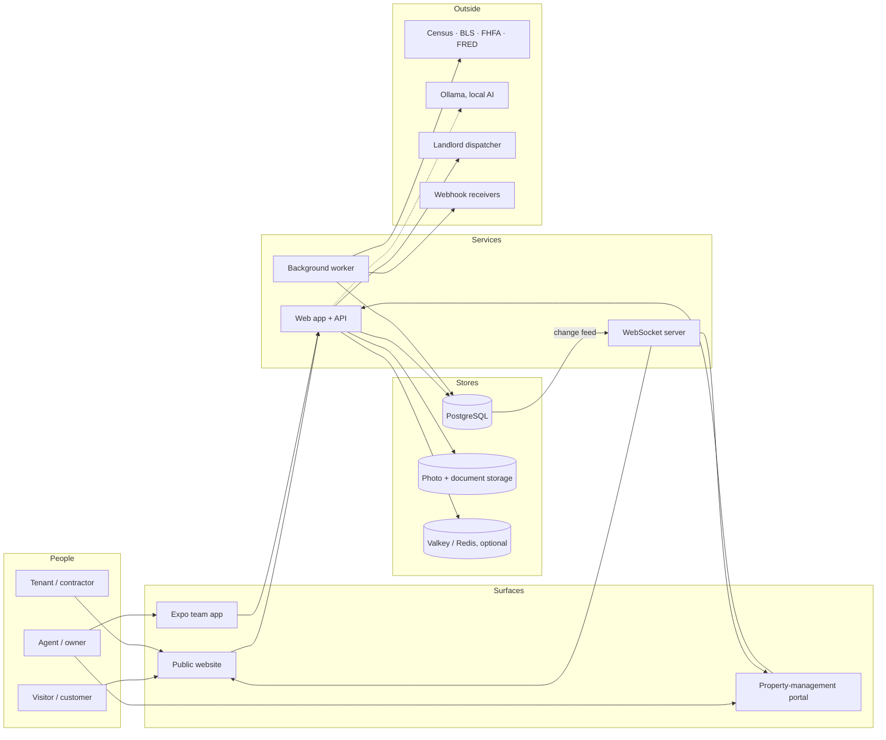

### Data inventory

| Data | Table(s) | Who can see it | Kept for |
| --- | --- | --- | --- |
| Listings and photos | `properties`, `media_assets`, storage `listings/` | Everyone (published), staff (drafts) | Until deleted by staff |
| Customer accounts | `users` (role `client`) | The customer; their assigned agent; owner | Until the customer deletes it |
| Staff accounts | `users` (role `agent` / `admin`) | Owner | Until deactivated |
| Saved homes, searches, comparisons, Dual-Move plans | `collections*`, `saved_searches`, `search_history`, `property_comparisons`, `dual_move_scenarios` | The customer (and their agent for shared collections) | Until the customer deletes them or the account |
| Leads (inquiries) | `leads`, `lead_notes`, `consent_records` | Assigned agent, owner | Until staff delete them |
| Deals | `transactions`, `transaction_milestones`, `transaction_tasks` | The deal's agent, owner; the client sees client-visible milestones | Until deleted by the owner |
| Deal documents | `transaction_documents`, storage `deals/` | The deal's agent, owner | Until deleted |
| Email drafts | `communication_drafts` | The deal's agent, owner | Until discarded |
| Website analytics | `analytics_events` | Owner (full), agents (their listings' engagement) | Project retention, default 395 days |
| Market & government data | `market_series`, `market_observations`, `gov_dataset_imports` | Everyone | Replaced on refresh |
| Audit trail | `audit_log` (append-only) | Owner | Kept |
| Events & jobs | `outbox_events`, `jobs` | System only | 7 days after completion |
| Idempotency keys, rate-limit counters | `idempotency_keys`, `rate_limit_counters` | System only | 24 hours / 2 hours |

Every request runs as a restricted database role with the caller's identity attached, so the
"who can see it" column is enforced by PostgreSQL row-level security, not only by code.

---

## 2. A visitor browses the site

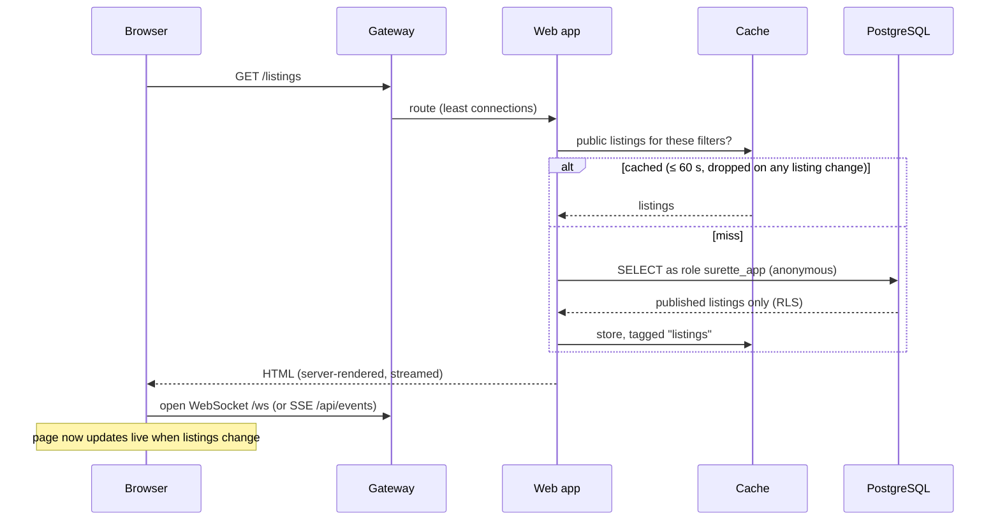

1. Pages render on the server. Public data comes from the in-app cache when possible.
2. The browser opens one live connection per tab. When a listing or photo changes, the browser
   receives only the id and re-fetches through the API.
3. Images are served as pre-sized WebP renditions (640, 1200 and 2400 px) with a long cache lifetime.
4. The analytics tracker loads but sends nothing until the visitor chooses "Allow" (see §9).

**If something is down:** cache miss → database. Database down → error page, and readiness takes
the instance out of the load balancer. WebSocket server down → the browser falls back to SSE.

---

## 3. Signing in (two separate entrances)

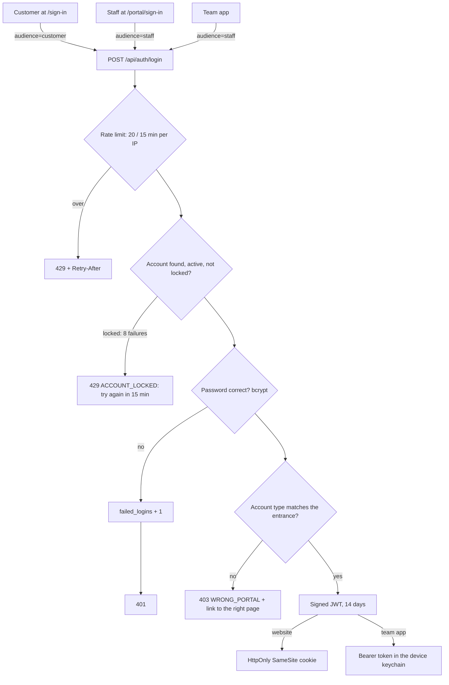

- Every API request re-reads the user row, so deactivation or a role change takes effect immediately.
- Cookie-authenticated writes from another website are refused (CSRF protection in `proxy.ts`).
- Staff accounts are created only by the owner (Portal → Team) or `npm run admin:create`.

---

## 4. A visitor becomes a lead

Leads come from the contact page, showing requests, the concierge hand-off and Dual-Move "send
to an agent".

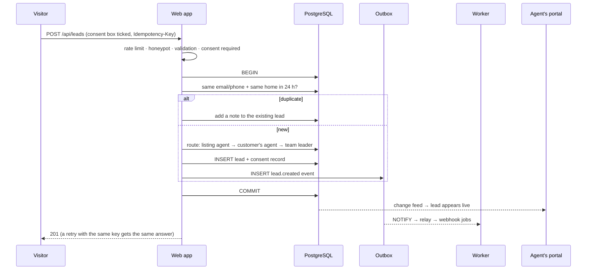

What's stored: name, email and/or phone, message, explicit preferences, the exact consent text
and time. Never stored: anything inferred about the person.

---

## 5. The concierge (chatbot)

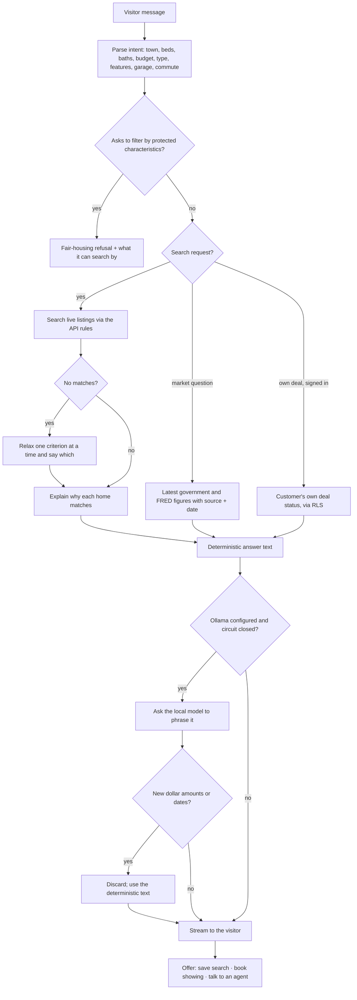

The concierge only mentions homes the database returned. AI is optional, runs on your own server
and never sees anything the deterministic answer didn't already contain.

---

## 6. Listing and photo upload (portal or team app)

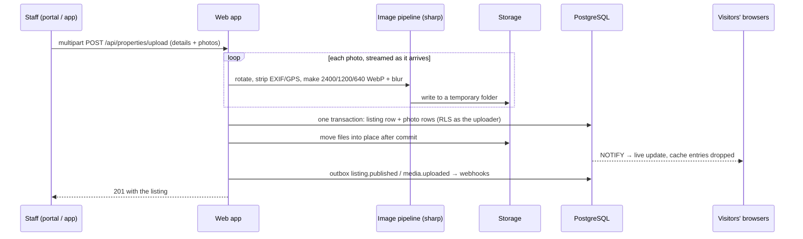

Limits: 40 photos, 30 MB each; JPEG, PNG, WebP, AVIF or HEIC only. Every file is decoded by the image pipeline, so anything that isn't really an image is rejected.

---

## 7. A deal from contract to closing

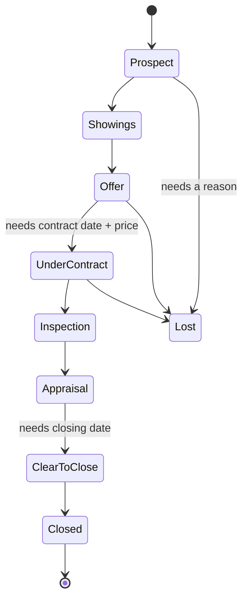

1. **Create** (board or from a lead). The side's checklist template is applied: each milestone
   and task gets a rule such as `contract+10:roll` (10 days after the contract, moved off weekends).
2. **Move stages.** Stage gates block a move until the required dates or price exist.
3. **Dates change.** Rule-based items are recalculated; items someone rescheduled by hand stay put.
4. **Documents.**
   1. Upload a PDF or image; the type is checked from the content.
   2. Text is scanned for price, deposit, dates and inspection days, each with the page it came from.
   3. A person verifies or rejects each value before anything is applied to the deal.
5. **Emails.**
   1. Drafts are generated from the deal's data.
   2. A person must approve the text before it can be marked "sent".
   3. Staff send it from their own email; the system never emails clients by itself.
6. **Record and notify.**
   - Every change is written to the append-only audit log.
   - Stage changes emit `deal.stage_changed`, delivered by webhook.
   - The client sees client-visible milestones in their account.

---

## 8. Showing requests

1. A visitor picks a slot on a listing (open slots come from `/api/showings/slots`).
2. The request is stored as `requested`. A database exclusion constraint makes double-booking a
   confirmed slot impossible.
3. The request also creates or updates a lead (§4), with consent.
4. The listing agent confirms or declines in the portal. The customer sees the status in their
   account, and the change is pushed live.

---

## 9. Website analytics (first-party, consent-based)

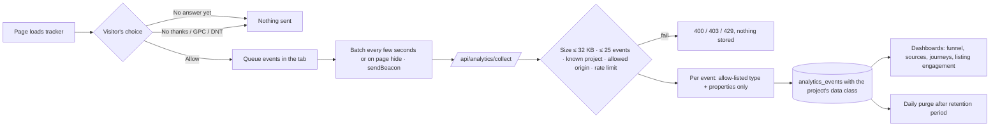

- **Projects:** `nexus-site` (production, this website), `demo-site` (synthetic), `e2e` (tests).
  The data class comes from the project, never from the browser.
- **Never collected:** form contents, names, emails, phone numbers, full IPs, cookies, or cross-site ids.
- **Identifiers:** a per-tab session id always; a pseudonymous visitor id only after "Allow".
- **Duplicates:** resent batches are ignored by event id.

---

## 10. Market and government data

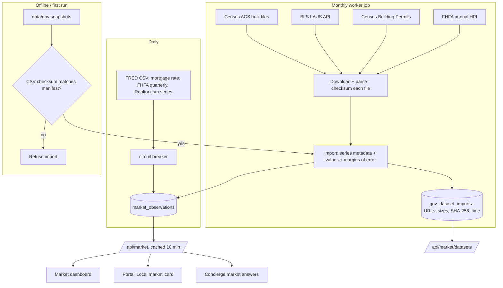

- **Downloads fail:** previous values stay, and the series records the error. Nothing is estimated.
- **Gaps stay gaps:** for example, BLS never collected October 2025.
- **Census figures:** shown with their margin of error.

---

## 11. Events, queue and webhooks

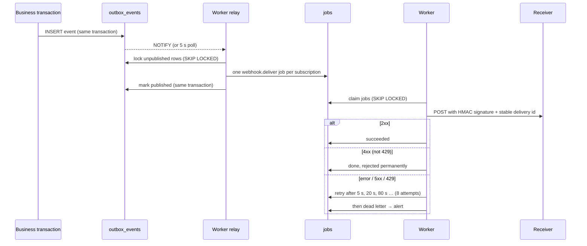

Recurring jobs (scheduled by whichever worker holds the leader lock):

| Job | Every | Does |
| --- | --- | --- |
| `maintenance.cleanup` | hour | Clears expired rate-limit counters and idempotency keys; removes old finished jobs and published events |
| `analytics.purge` | day | Deletes analytics events past each project's retention |
| `market.refresh` | day | FRED series |
| `govdata.refresh` | 30 days | Census, BLS, FHFA downloads |

---

## 12. Live updates

1. A database trigger publishes `{table, op, ids, visibility, team}` on the `surette_events` channel
   after every relevant change, whoever made it.
2. Each web and realtime instance keeps one LISTEN connection.
3. For each connected client, the shared visibility rules decide whether to forward the event:
   public listing changes go to everyone; staff changes go to that team's staff; a customer gets
   their own showings and deal; collection activity goes to its owner and agent.
4. The client re-fetches the changed item through the API, where row-level security applies again.

---

## 13. Maintenance requests and contractors

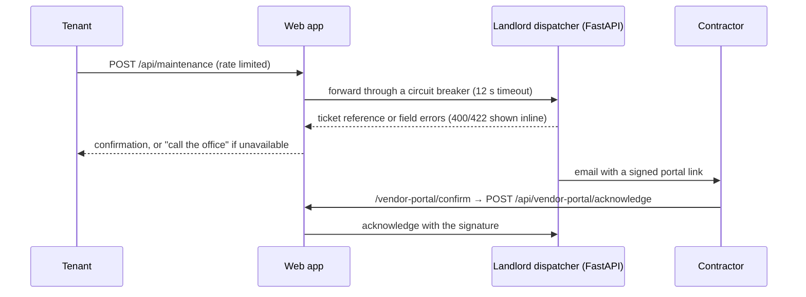

Staff see vendor insurance status in Portal → Vendors (read from the dispatcher).

---

## 14. Customer privacy controls

| Action | Where | What happens |
| --- | --- | --- |
| Change analytics choice | `/privacy`, banner | Stored in the browser; "No thanks" also removes the visitor id |
| Export my data | Account → Export | JSON of the account, collections and comments, saved searches, search history, comparisons, Dual-Move scenarios, showings and consent records |
| Delete my account | Account → Delete (password required) | Account and everything stored for it are deleted. Leads already sent to the team are unlinked; the office can erase those on request |
| Withdraw contact consent | Ask the office | Consent record updated; staff stop contact |

---

## 15. When things fail

| Failure | What visitors see | What staff see | Recovery |
| --- | --- | --- | --- |
| One web instance crashes | Nothing (others serve) | — | Restarted by Docker / Kubernetes |
| Database unreachable | Error page | Portal unavailable; critical alert | Failover (CloudNativePG) or restart |
| Worker down | Nothing | Webhooks and refreshes wait; alert after 5 min | Start a worker; queued work drains |
| Ollama down | Built-in answers | — | Breaker retries every 30 s |
| Census / BLS / FHFA / FRED down | Last stored data with its date | Series shows its last error | Next scheduled refresh |
| Dispatcher down | "Call the office" message | Vendors page unavailable | Breaker retries every 30 s |
| Redis down | Nothing | Warning alert | Falls back to Postgres limits and in-app cache |
| WebSocket server down | Updates continue over SSE | — | Restart |
| Traffic spike | Slightly slower pages | Latency and pool alerts | Autoscaling adds web pods |
